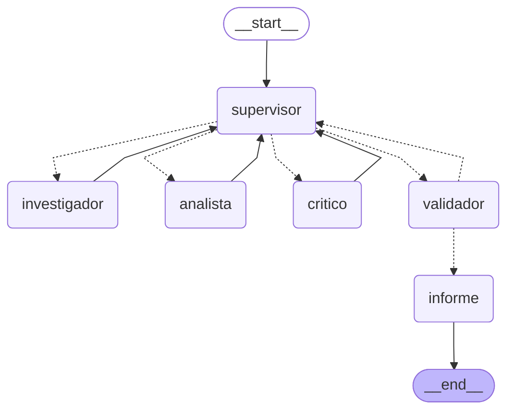

# Orquestador multi-agente de due diligence de startups de IA

Pre-entrega 6 de **AI Engineering (Coderhouse)**: un sistema **jerárquico** construido con **LangGraph**, con un **supervisor** que delega en tres especialistas y una **compuerta de validación** antes de cerrar.

**El caso de uso:** un analista de un fondo de inversión pide la *due diligence* de una startup de IA. El sistema hace cuatro cosas:

1. Lee el data room de la startup.
2. Verifica cada número contra su fuente.
3. Calcula el costo real de los LLM que usa la startup y sus unit economics.
4. Busca lo que el pitch no muestra.

El resultado es un informe con una **recomendación preliminar**: *avanzar a comité*, *profundizar*, *no avanzar* o *sin recomendación*. Esta última aparece cuando faltan datos. La decisión final queda en manos humanas; esa aprobación se agrega en la PE7.

| Especialista | Qué hace | Herramientas |
|---|---|---|
| **investigador** (búsqueda) | Lee el data room y fuentes de mercado. Registra métricas y hallazgos **con su cita literal** | `leer_documento`, `buscar_en_data_room`, `buscar_mercado` (web con Tavily o corpus local), `registrar_metricas`, `registrar_hallazgos` |
| **analista** (cómputo) | Convierte las métricas en números de decisión, **solo con herramientas** | `calcular_costo_llm`, `calcular_unit_economics`, `estimar_tamano_mercado`, `calcular_scoring` |
| **crítico** (auditoría / árbitro) | Contrasta lo declarado con lo calculado, busca letra chica y registra red flags (riesgos de la startup) y correcciones (errores del equipo) | `contrastar_metricas`, `buscar_evidencia`, `registrar_observaciones` |

> **Datos ficticios.** Las tres startups (Contralia, VozActiva y Aula Viva), sus data rooms, los informes de mercado y el fondo son inventados para la demo. Las cifras de mercado son ilustrativas.

## El grafo

Diagrama generado con `grafo.get_graph().draw_mermaid()` (`python dibujar_grafo.py` lo guarda en `docs/grafo.mmd`). Las flechas punteadas son aristas condicionales:



| Arista | Tipo | Condición |
|---|---|---|
| `supervisor → investigador / analista / critico` | condicional (`ruta_supervisor`, retorna `Literal[...]`) | La decisión estructurada del supervisor (`DecisionSupervisor.siguiente`), después de las guardas |
| `supervisor → validador` | condicional | El supervisor eligió `"finalizar"` |
| `investigador / analista / critico → supervisor` | fija | Los especialistas **siempre** vuelven al supervisor: nunca se hablan entre ellos |
| `validador → informe` | condicional (`ruta_validador`, `Literal["supervisor", "informe"]`) | La rúbrica se cumple, o no quedan pasos (en ese caso, el informe sale sin recomendación) |
| `validador → supervisor` | condicional | La rúbrica falla y quedan pasos: el supervisor recibe los errores puntuales (bucle de reparación) |
| `informe → END` | fija | Síntesis determinística, sin LLM |

Recorrido de VozActiva en la demo (`demo.ipynb`, Gemini real):

```
[paso 1] supervisor → investigador : relevá el data room            → 20 métricas ancladas, 4 hallazgos
[paso 2] supervisor → analista     : calculá costo LLM y unit econ. → margen real 41,9 % (declarado: 74 %)
[paso 3] supervisor → critico      : auditá el análisis v1           → 4 red flags altas (2 por regla de contraste)
[paso 4] supervisor → finalizar    → validador: aprobada → informe: NO AVANZAR (score 41/100)
```

Aula Viva recorre la rama de refinamiento por datos faltantes:

1. El supervisor vuelve a mandar al investigador con la lista de faltantes.
2. Tras la segunda búsqueda, lo que no está queda como "no disponible".
3. El analista calcula lo posible y el crítico audita.
4. El validador aprueba con salvedades.
5. El informe se abstiene.

El ciclo completo crítico → corrección → re-análisis → re-auditoría quedó registrado en corridas reales previas (ver [Límites observados](#límites-observados-y-qué-se-cambió)) y lo cubre `tests/test_graph.py`.

## Por qué esta topología

**Elegí la jerárquica (supervisor) y no la cooperativa.** Una due diligence es un **workflow determinista con dependencias**: no se puede calcular sin datos ni auditar sin cálculos. Además exige **trazabilidad**, porque el comité tiene que saber de dónde sale cada número. El criterio de la clase ("workflow determinista va jerárquico, problema explorativo va cooperativo") lo deja claro. Un pizarrón compartido entre pares haría difícil responder "¿quién cambió este dato y por qué?".

Lo que se gana:

- **Control centralizado:** el supervisor es el único que decide el orden y el único que puede cerrar.
- **Especialización:** cada agente tiene un prompt corto, herramientas acotadas y una parcela del estado propia. El supervisor no ejecuta: no busca, no calcula y no redacta.
- **Escalabilidad:** sumar un especialista (el redactor de la PE7) es agregar un nodo, su parcela y una opción en el `Literal`.

El riesgo de la jerarquía es que el supervisor sea un cuello de botella o entre en un bucle infinito. Las dos cosas se mitigan con un **tablero** compacto (no lee el historial) y con frenos duros (ver [Condiciones de parada](#condiciones-de-parada-el-supervisor-infinito)).

Hay una variante de colaboración **dentro** de la jerarquía: el **crítico** cumple el rol del agente árbitro (*critic/refiner* de la clase). Pero sus correcciones no van directo al agente afectado, pasan por el supervisor. Así el ciclo crítico ↔ analista también tiene freno.

## Decisiones de diseño

### Estado compartido (`state.py`)

`EstadoDD` hereda de **`MessagesState`** y es el contrato entre agentes. Se definió antes de escribir ningún agente.

| Grupo | Campos | Quién escribe |
|---|---|---|
| Historial | `messages` (reducer `add_messages`): el pedido del usuario y un resumen por paso de cada agente | todos (append) |
| Control | `siguiente` (el *next_agent*), `instruccion`, `pasos`, `intentos`, `motivo_cierre` | **solo** el supervisor |
| Parcelas | `investigacion`, `analisis`, `critica`, `validacion`, `informe` + `recomendacion` + `tarea_completa` | **una por agente** |
| Proveniencia | `aportes` (reducer `operator.add`): quién aportó qué en cada paso | todos (append-only) |

- **Contratos Pydantic:** cada parcela es un modelo (`Investigacion`, `Analisis`, `Critica`, `Validacion`). Los datos se validan *antes* de entrar al estado compartido.
- **Aislamiento de escritura:** `PARCELAS` define qué claves puede escribir cada nodo, y `graph.con_parcela` envuelve cada nodo y lanza `EscrituraFueraDeParcela` si escribe fuera de la suya. No hay condiciones de carrera: el analista nunca puede pisar un dato del investigador.
- **Aislamiento de lectura:** cada especialista declara un `input_schema` (`EntradaInvestigador`, `EntradaAnalista`, `EntradaCritico`) y LangGraph le pasa **solo esas claves**. Ninguno lee el historial de mensajes.
- **Versionado:** cada parcela tiene `version`. El análisis guarda con qué versión de la investigación se calculó, y la crítica guarda qué versión del análisis auditó. Así la rúbrica detecta trabajo "viejo" cuando un dato cambia.
- **Proveniencia de cada dato:** cada métrica guarda `fuente` (id del fragmento) y `cita` literal, y cada cálculo guarda sus `entradas` y su `resultado`.
- **Checkpoints:** el grafo compila con `InMemorySaver`. Los contratos se registran en el serializador (`state.serializador()`), porque langgraph-checkpoint 4 avisa que deserializar tipos no registrados "se va a bloquear en una versión futura". Queda listo para el `RedisSaver` de la PE7.

### Los especialistas (`agents/`)

Cada especialista es un **agente ReAct**: el patrón de la PE5 (LLM con `bind_tools` + `ToolNode` + `tools_condition`) generalizado en `agents/react.py`. Equivale a `create_react_agent`, que **LangGraph 1.0 deprecó** a favor de `langchain.agents.create_agent`. Lo armé a mano para controlar tres cosas:

1. la política de reintentos (`llm.es_reintentable`);
2. un freno de rondas de herramientas por invocación;
3. el prompt de rol.

Se compila con `checkpointer=False`: su conversación interna con las herramientas no entra al estado compartido.

**Contaminación de contexto:** cada especialista arranca con un historial **nuevo** de dos mensajes:

1. su prompt de rol;
2. la instrucción específica del supervisor, más el **contexto mínimo** que necesita.

Ese contexto mínimo es distinto para cada uno. El analista recibe la tabla de métricas registradas y los hallazgos. El crítico recibe métricas, hallazgos y resultados del análisis. A cada uno le llegan solo las correcciones dirigidas a él. Nadie ve el historial ni el tablero del supervisor (hay tests que lo verifican).

| Agente | Garantía determinística (no depende del LLM) | Lo que NO hace |
|---|---|---|
| investigador | **Anclaje** (la idea de `anclar_al_texto` de la PE2). Una métrica entra solo si su cita está literalmente en un fragmento y el valor aparece en la cita. Las métricas de la startup solo valen de **su** data room. Los rechazos vuelven con el motivo y el agente los corrige (bucle de reparación) | No calcula ni opina sobre la inversión |
| analista | **Proveniencia**. Toda entrada numérica tiene que coincidir con la métrica registrada del mismo nombre o con un cálculo previo. Si no, la herramienta no calcula y dice qué valor usar. Las únicas entradas libres son juicios explícitos con justificación (`cuota_som_pct`, escenarios, puntajes de equipo y mercado). Las fórmulas viven en `finanzas.py`, son puras y están testeadas | No busca información ni evalúa riesgos |
| crítico | **Contraste**. `contrastar` compara margen y runway declarados con los calculados, y sus discrepancias entran **siempre** como red flags de origen `contraste`. Las red flags exigen cita literal. Las correcciones al investigador deben nombrar la métrica, el valor correcto y una cita que lo contenga, y se rechazan si ese valor ya está registrado. Las duplicadas se descartan y hay un máximo de 2 registros por revisión | No recalcula, no cambia datos, no decide la inversión |

#### La búsqueda: Tavily o búsqueda simulada

La consigna da dos opciones para el investigador: **Tavily** o una **búsqueda simulada sobre la Vector DB de las pre-entregas anteriores**. La herramienta `buscar_mercado` implementa las dos ideas:

| Modo | Cuándo | Cómo |
|---|---|---|
| **Web (Tavily)** | Hay `TAVILY_API_KEY` en el `.env` | `TavilySearch` (paquete `langchain-tavily`, el reemplazo de `TavilySearchResults`). Cada resultado se guarda como fragmento `web:N` y pasa por el mismo anclaje que el data room |
| **Búsqueda simulada** | No hay clave, o Tavily falla | Busca en los informes de mercado locales (`data/mercado/`), que hacen de fuente externa. Índice **BM25** (rank-bm25) con el tokenizador en español de la PE4 |

**La demo entregada corrió en modo simulado** (sin clave de Tavily). El modo web está cubierto por tests (`tests/test_herramientas.py`: un resultado web se ancla como cualquier fuente y, si la web falla, se busca en el corpus local), pero todavía no tiene una corrida real contra Tavily.

**Por qué no la Vector DB de las pre-entregas anteriores.** Las PE3 a PE5 trabajaron sobre otro tema: el handbook de ingeniería de Órbita Pagos, una empresa ficticia (indexado en ChromaDB en la PE3 y en Pinecone en la PE4). Desde esta pre-entrega el proyecto **cambió de tema** a due diligence de startups de IA, que es el tema del proyecto final, así que ese índice no tiene nada útil para buscar acá. En su lugar armé un corpus nuevo (data rooms, informes de mercado y la tesis del fondo: 72 fragmentos por sección, con id estable como `vozactiva/finanzas#4`) y lo indexé con BM25:

- con 72 fragmentos no hace falta una base vectorial;
- no gasta cuota de embeddings y da el mismo resultado en cada corrida;
- encuentra bien los términos exactos que importan en una due diligence: cifras, nombres de métricas y clientes.

En el proyecto final, el recuperador híbrido de la PE4 (BM25 + vectores con `EnsembleRetriever`) reemplaza al BM25 sobre este mismo corpus, sin cambiar la herramienta del investigador.

### El supervisor (`agents/supervisor.py`)

- **Tablero en lugar de historial.** Su prompt recibe un resumen armado de forma determinística:
  - el estado de cada especialista y sus intentos;
  - la **rúbrica de suficiencia** con marcas `[x]`, `[ ]` y `[!]`;
  - las correcciones pendientes;
  - el último rechazo del validador;
  - las decisiones anteriores.

  El prompt no crece con cada vuelta.
- **Salida estructurada** `DecisionSupervisor(razonamiento, siguiente: Literal["investigador","analista","critico","finalizar"], instruccion)`, con `with_structured_output(method="json_schema")`. Ese método es el que funciona en los tres proveedores (los Claude 5.5 rechazan el `tool_choice` forzado del modo por defecto).
- **Rúbrica en el prompt** y reglas de decisión: correcciones al dueño del dato, re-auditar si el análisis cambió, no volver a un agente agotado.
- **Guardas determinísticas.** Se aplican después del LLM y quedan registradas en `aportes` como `[guarda: ...]`:
  1. **límite de pasos:** la última decisión es siempre `finalizar` y no consulta al LLM;
  2. **dependencias:** si elige al analista sin investigación, va el investigador; si elige al crítico sin análisis, va el analista;
  3. **especialista agotado:** se pasa al siguiente pendiente de la rúbrica;
  4. **insistir en cerrar después de un rechazo del validador,** habiendo algo resoluble: se pasa a ese pendiente;
  5. **salida inválida del LLM:** plan B, el siguiente pendiente de la rúbrica.

  Un error del proveedor (key, cupo diario) no se tapa: corta el análisis con un mensaje claro.

### Validación (`validation.py`)

**Determinística antes que semántica.** Las reglas que el código resuelve con certeza no se le piden a otro LLM. La misma rúbrica se usa en tres lugares, así nunca se contradicen:

1. en el tablero del supervisor;
2. en sus guardas (`siguiente_pendiente`);
3. en el nodo `validador`, antes del END.

| Check | Falla si… | Lo resuelve |
|---|---|---|
| `investigacion` | menos de 6 métricas ancladas o menos de 2 hallazgos con cita | investigador |
| `metricas_clave` | falta alguna de las 16 métricas clave. Después de 2 búsquedas pasa con **advertencia** ("no disponible en las fuentes") | investigador |
| `correcciones_investigador` | hay correcciones de severidad alta sin atender | investigador |
| `analisis_vigente` | no hay análisis, se calculó con una investigación vieja o faltan cálculos posibles | analista |
| `correcciones_analista` | hay correcciones de severidad alta sin atender | analista |
| `critica_vigente` | el crítico no auditó la versión vigente del análisis | crítico |

Si el responsable de un check ya agotó sus intentos, el check pasa con **advertencia**: lo irresoluble no bloquea el cierre, pero queda escrito en el informe.

### Cómo se manejan los conflictos entre agentes

Ejemplo real de la primera corrida: el pitch de VozActiva dice "MRR de USD 120.000", pero el documento de métricas aclara que USD 30.000 son pilotos por única vez. Además, el análisis v1 se calculó sin los costos de voz y telefonía y dio un margen de 81 %. Así se resuelven ese tipo de choques:

1. **Trazabilidad de proveniencia, no votación.** Cada afirmación en conflicto tiene fuente y cita, y la que gana es la que cumple la definición del vocabulario de métricas (`METRICAS`: *"MRR recurrente, SIN pilotos"*). Votar entre agentes no sirve: con el mismo modelo, alucinan igual.
2. **Un árbitro con evidencia.** El crítico es el único que audita, y solo puede registrar red flags o correcciones respaldadas por una cita literal.
3. **La corrección vuelve al dueño del dato.** El crítico no puede cambiar la parcela del investigador. Emite `C1 → investigador`, el supervisor se la delega y el investigador la re-registra (la herramienta la vuelve a anclar). El cambio queda en `investigacion.reemplazos`. La corrección cuenta como atendida **solo si el dato quedó con el valor pedido**; si no, la rúbrica la vuelve a exigir hasta que el investigador agote sus intentos. Después, la rúbrica detecta que el análisis quedó viejo y lo manda a recalcular.
4. **Contraste determinístico.** "Margen declarado 74 % vs. calculado 41,9 %" no depende de que el LLM lo note: lo calcula una regla.
5. **Correcciones verificables.** Una corrección al investigador que pide un valor ya registrado se rechaza. Esto evita el clásico "el crítico siempre encuentra algo".
6. **Cuando no hay salida, abstenerse.** Si después de los intentos un dato no está, queda como salvedad. Si faltan 3 o más métricas clave, o la validación no se supera, el informe sale **SIN RECOMENDACIÓN** y se escala a un analista humano.

### Condiciones de parada (el supervisor infinito)

| Freno | Valor por defecto | Qué corta |
|---|---|---|
| `DD_MAX_PASOS` | 12 decisiones | La última decisión es `finalizar` sin consultar al LLM. Si la rúbrica no se cumplió, el informe se abstiene |
| `DD_MAX_INTENTOS_*` | investigador 3, analista 3, crítico 2 | El bucle crítico ↔ analista. Un especialista agotado no se vuelve a llamar |
| `DD_MAX_ITERACIONES_ESPECIALISTA` | 6 rondas | El ciclo ReAct interno de cada especialista |
| `MAX_REGISTROS` del crítico | 2 por revisión | Que el crítico registre observaciones en bucle |
| `DD_RECURSION_LIMIT` | 40 super-pasos | Freno duro de LangGraph (`GraphRecursionError`). Se valida que supere `2 × max_pasos + 3` |

### Síntesis final (`informe.py`)

El informe se arma **sin LLM**, solo con las parcelas validadas, así que la fase final no puede alucinar. La recomendación sigue reglas explícitas:

- **SIN RECOMENDACIÓN** si la validación no se superó o si faltan 3 o más métricas clave;
- si no, la banda del scoring;
- una red flag de severidad alta impide *avanzar a comité*.

El scoring usa los umbrales y pesos de la tesis del fondo (`data/fondo/tesis-de-inversion.md`): unit economics 25 %, margen 20 %, runway 15 %, crecimiento 15 %, equipo 10 %, mercado 10 % y concentración 5 %.

## Estructura

```
├── state.py              # EstadoDD (MessagesState) + contratos Pydantic + PARCELAS + input_schema por agente
├── agents/
│   ├── react.py          # Agente ReAct reutilizable (patrón de la PE5) para cada especialista
│   ├── supervisor.py     # Tablero, DecisionSupervisor (Literal), guardas determinísticas
│   ├── research_agent.py # Investigador: lectura, búsqueda, anclaje de métricas y hallazgos
│   ├── analyst_agent.py  # Analista: 4 herramientas de cálculo con regla de proveniencia
│   ├── critic_agent.py   # Crítico: contraste determinístico, evidencia, red flags y correcciones
│   └── comun.py          # Formato de herramientas y del contexto mínimo
├── graph.py              # StateGraph: nodos, aristas condicionales con Literal, aislamiento de escritura
├── validation.py         # Rúbrica de suficiencia + nodo validador + ruta del validador
├── informe.py            # Síntesis determinística y recomendación preliminar
├── finanzas.py           # Fórmulas puras: costo de LLM, unit economics, TAM/SAM/SOM, scoring
├── corpus.py             # Data rooms por sección, BM25, anclaje de citas, números en formato rioplatense
├── busqueda_web.py       # Tavily opcional con fallback al corpus local
├── tracing.py            # Recorrido del grafo + llamadas y tokens por agente (ContadorLLM)
├── orquestador.py        # Ensamblado desde el .env
├── analizar.py           # CLI
├── dibujar_grafo.py      # docs/grafo.mmd (+ ASCII)
├── demo.ipynb            # Demo ejecutada (entregable)
├── llm.py, config.py, lexico.py, formato.py, logging_setup.py
├── data/                 # startups/{contralia,vozactiva,aulaviva}, mercado/, fondo/
├── informes/             # Informes generados por la demo
├── trazas/               # Trazas JSON de la demo
└── tests/                # Tests offline con pytest (LLM guionado)
```

## Instalación

Requiere Python 3.12 o superior.

```bash
python -m venv .venv
# Windows: .venv\Scripts\activate    |    Linux/macOS: source .venv/bin/activate
pip install -r requirements-dev.txt   # o requirements.txt si no vas a ejecutar el notebook ni los tests
cp .env.example .env                  # y completá la API key del proveedor elegido
```

El proveedor por defecto es Gemini, igual que en las pre-entregas anteriores. Para usar OpenAI o Anthropic alcanza con `LLM_PROVIDER=openai` (o `anthropic`) y su API key, sin tocar código. `llm.py` es el de las PE2–PE5, con un agregado: un mensaje propio para cuando el proveedor sigue saturado después de los reintentos (ver [Errores y cómo reaccionar](#errores-y-cómo-reaccionar)).

### Modelos por defecto (IDs reales de cada API)

| Proveedor | Modelo por defecto | Variable | Fuente (verificada el 2026-11-05) |
|---|---|---|---|
| Gemini | `gemini-3.5-flash-lite` (respaldo: `gemini-3.1-flash-lite`) | `GEMINI_MODEL` | [Google AI](https://ai.google.dev/gemini-api/docs/models) |
| OpenAI | `gpt-4o-mini` (deprecado: se da de baja el 2027-01-14, reemplazo `gpt-6-luna`) | `OPENAI_MODEL` | [OpenAI](https://developers.openai.com/api/docs/deprecations) |
| Anthropic | `claude-sonnet-5-5` (retiro no antes de 2027-09-28) | `ANTHROPIC_MODEL` | [Anthropic](https://platform.claude.com/docs/en/about-claude/models/overview) |

**Por qué Flash Lite.** El plan gratuito de Gemini da 15 requests por minuto y 500 por día a Flash Lite, contra 5 y 20 de los Flash. Una due diligence usa entre 15 y 40 requests (ver [Resultados](#resultados-de-las-corridas-reales)), así que con un Flash el cupo diario no alcanza ni para la demo. `LLM_REQUESTS_PER_MINUTE=12` activa un `InMemoryRateLimiter` compartido por los cuatro roles. Se puede usar un modelo distinto para el supervisor con `DD_MODELO_SUPERVISOR` ("uno caro para coordinar y livianos para ejecutar").

**Sampling por proveedor** (`llm.parametros_sampling`, igual que en las PE anteriores):

- OpenAI y Gemini 2.x: `LLM_TEMPERATURE` se envía si está definida.
- Gemini 3.x: no se envía, porque Google la deprecó.
- Anthropic: no se envía, porque desde Claude Opus 4.7 la API responde 400.

En los dos últimos casos se loguea un aviso. La conducta del sistema la fijan los prompts de rol, los contratos de las herramientas y las validaciones determinísticas, no la temperatura.

## Ejecución

```bash
python analizar.py --listar                 # startups disponibles
python analizar.py --startup vozactiva      # due diligence completa → informes/vozactiva.md + trazas/vozactiva.json
python analizar.py --startup contralia --pedido "¿Aguanta el margen si el uso de LLM se duplica?"
python analizar.py --startup aulaviva -v    # -v muestra las rondas de herramientas de cada especialista
python dibujar_grafo.py                     # docs/grafo.mmd + diagrama ASCII
```

**Demo (entregable): `demo.ipynb`**, ejecutado con Gemini real y con las salidas guardadas. Muestra los tres casos, el recorrido de delegación en vivo, quién aportó qué, la proveniencia de los datos, la validación, el informe, las llamadas y tokens por agente y el historial de checkpoints. Para re-ejecutarlo: `jupyter nbconvert --to notebook --execute --inplace demo.ipynb`.

`draw_mermaid_png()` no se usa por defecto porque envía el diagrama al servicio público mermaid.ink. `python dibujar_grafo.py --png` lo hace si se quiere la imagen.

## Resultados de las corridas reales

Ejecución de `demo.ipynb` del 2026-11-11 con `gemini-3.5-flash-lite` (thinking `low`, 12 requests/min). Los informes quedaron en `informes/` y las trazas en `trazas/`:

| Startup | Recomendación | Score | Pasos del supervisor | Delegaciones (inv/ana/cri) | Llamadas al LLM | Tokens | Tiempo |
|---|---|---|---|---|---|---|---|
| VozActiva | **NO AVANZAR** | 41 | 4 | 1/1/1 | 19 | 77.791 | 97 s |
| Contralia | **AVANZAR A COMITÉ** | 92 | 4 | 1/1/1 | 20 | 79.122 | 103 s |
| Aula Viva | **SIN RECOMENDACIÓN** (faltan 13 métricas clave) | 12 | 5 | 2/1/1 | 20 | 53.869 | 102 s |

- **VozActiva:** el pitch declara MRR de USD 120.000, margen de 74 % y runway de 20 meses. El sistema registra:
  - MRR recurrente de USD 90.000;
  - costos directos totales de USD 26.000 más USD 16.800 de LLM (18,7 % del MRR);
  - **margen real de 41,9 %**, LTV/CAC de 0,93 y **runway de 7,4 meses**.

  Las dos discrepancias entran por la regla de contraste, y el crítico suma el runway que cuenta un préstamo sin firmar y la concentración en TelcoAndina (46 % del MRR, con el contrato en renegociación).
- **Contralia:** margen de 71,3 % (declarado: 72 %, dentro de la tolerancia), LTV/CAC de 5,8, payback de 9,6 meses y runway de 24 meses.
- **Aula Viva:** solo 5 métricas están en las fuentes. Tras 2 búsquedas, el resto queda como "no disponible", la validación aprueba con salvedades y el informe pide los datos a la startup en lugar de inventarlos.
- Durante la corrida, Gemini respondió **dos veces 503 "high demand"**. Los dos se reintentaron solos (`LLM_MAX_RETRIES=2`) sin cortar el análisis.
- El anclaje rechazó registros mal citados y la regla de proveniencia rechazó llamadas del analista con números sin respaldo. Las dos cosas quedan contadas en cada parcela, y los agentes se corrigieron en la ronda siguiente.

### Límites observados (y qué se cambió)

Las corridas previas a la demo sirvieron para endurecer el sistema. Los cambios están en el código y en los tests:

1. **Primera corrida con el CLI (38 llamadas):**
   - El investigador no registró el margen ni el runway *declarados* (así que la regla de contraste no tenía con qué comparar) ni los costos directos. El análisis v1 dio un margen inflado de 81 %.
   - El crítico lo detectó y el flujo de corrección funcionó: investigador v2, analista v2 con 41,9 %. Pero también emitió una corrección falsa (pedía cambiar un MRR que ya estaba bien) y una duplicada.

   Cambios:
   - `leer_documento` y la lista completa de métricas faltantes en el mensaje del investigador;
   - los costos, el crecimiento y la concentración pasaron a ser métricas clave;
   - la rúbrica exige hallazgos;
   - las correcciones al investigador tienen que ser verificables (métrica + valor + cita) y se descartan las duplicadas.

   La corrida siguiente bajó a 17 llamadas.
2. **Primera ejecución del notebook:** el investigador registró como "otros costos directos" la línea *Voz y telefonía* (USD 21.000) en lugar del **total** (USD 26.000). El margen dio 47,4 % en vez de 41,9 % (la recomendación no cambió).
   - **El anclaje garantiza que el número existe en la fuente, no que sea el correcto para la definición**, y el crítico no lo vio.
   - Se reforzaron la definición de la métrica y los prompts del investigador ("si hay línea de total, va el total") y del crítico (verificar totales contra subtotales). La demo entregada registra el total.
   - Sigue siendo un límite de cualquier sistema basado en LLM: por eso la decisión final es humana (PE7).
3. **El juicio del crítico varía entre corridas.** Por ejemplo, en una corrida marcó la dependencia de un único proveedor de LLM en Contralia como riesgo medio y en otra no. Lo estable es lo determinístico: las fórmulas, el anclaje, la proveniencia y las reglas de contraste dan lo mismo en cada corrida.

## Errores y cómo reaccionar

**Errores que reciben los agentes** (como `ToolMessage`; el grafo nunca se corta):

| Estructura | Cuándo | Qué hace el agente |
|---|---|---|
| `registrar_metricas → rechazadas: "La cita no aparece literalmente en el data room de vozactiva"` | Cita parafraseada, o un dato de otra startup | Copia la línea literal del fragmento y reintenta |
| `rechazadas: "El valor 0.065 no aparece en la cita (números en la cita: ['6.5'])"` | Porcentaje como fracción o número mal transcripto | Reintenta con el número tal como figura |
| `calcular_* → {"error": "Hay entradas sin respaldo", "campos": [{"campo": "mrr_usd", "sugerencia": "usá 90000"}]}` | El analista pasó un número que no está registrado | Usa el valor sugerido u omite el campo (se autocompleta) |
| `{"error": "Faltan datos de uso o de precio del LLM..."}` | No hay métricas de LLM registradas | Lo informa en su resumen; la rúbrica no exige ese cálculo |
| `registrar_observaciones → rechazadas: "mrr_usd ya está registrada con 90000"` | Corrección innecesaria del crítico | No la repite |
| `{"error": "Ya registraste observaciones 2 veces..."}` | El crítico registra en bucle | Cierra con su resumen |
| `ToolMessage(status="error")` (de `ToolNode(handle_tool_errors=True)`) | Argumentos fuera del `args_schema` | Corrige los argumentos |

**Errores que resuelve el orquestador** (sin intervención):

| Situación | Qué pasa |
|---|---|
| El supervisor devuelve una salida inválida | Plan B: sigue la rúbrica (`siguiente_pendiente`), con la guarda registrada en `aportes` |
| El supervisor elige un agente sin prerrequisitos, agotado, o insiste en cerrar con algo resoluble | Guardas determinísticas |
| 429 por minuto, 503 "high demand" de Gemini, timeout | Reintentos con backoff (`LLM_MAX_RETRIES`) en supervisor y especialistas. Pasó en la primera corrida real y se recuperó solo. Si una misma llamada falla en todos los intentos, el análisis corta con un mensaje claro (tabla siguiente) |
| Un dato no está en el data room | Queda como "no disponible" tras 2 búsquedas; con 3 o más faltantes el informe se abstiene |

**Errores que ve quien corre `analizar.py`** (sin *traceback*):

| Mensaje | Cuándo | Qué hacer |
|---|---|---|
| `Configuración inválida: falta la API key de gemini...` | Falta la key del proveedor | Completarla en el `.env` |
| `Configuración inválida: recursion_limit debe ser mayor que 2 * max_pasos + 3 (revisá el .env)` | `DD_*` incoherentes (o `Configuración inválida: max_pasos: ...` si un valor está fuera de rango) | Corregir el `.env` según el campo indicado |
| `No existe la startup 'x'. Opciones: ...` | Id mal escrito | Usar `--listar` |
| `Error del proveedor del LLM (...): se agotó el cupo DIARIO de este modelo` | 429 con quotaId `...PerDay...` | **No se reintenta.** Pasar a `GEMINI_MODEL=gemini-3.1-flash-lite` o esperar al reinicio (≈ 05:00 ART) |
| `Error del proveedor del LLM (...): la API key fue rechazada` / `el modelo no existe` | 401/403/400 de key, 404 | Revisar `*_API_KEY` / `*_MODEL` |
| `Error del proveedor del LLM (GoogleAPIError): error transitorio del proveedor (servidor saturado, p. ej. 503, o sin conexión)...` | El 503 "high demand" de Gemini (o la red caída) se repitió en todos los intentos de una misma llamada. Pasó en una prueba del 2026-11-12, durante un pico de demanda de Google | **No es la configuración.** Esperar unos minutos y reintentar, subir `LLM_MAX_RETRIES` o pasar a `GEMINI_MODEL=gemini-3.1-flash-lite` |
| `✘ Se alcanzó el recursion_limit (40) sin llegar al informe` | Freno duro | Queda en la traza; revisar `DD_*` |

Un error propio del código (un bug) sí muestra el *traceback*, a propósito: no se esconde.

## Tests

```bash
pip install -r requirements-dev.txt
pytest
```

124 tests **offline**: no hay llamadas a la API. El grafo, los nodos, las herramientas, el anclaje y las fórmulas son reales; lo único guionado es el LLM (`tests/conftest.py`: `ScriptedChatModel` soporta `bind_tools` y `with_structured_output`).

| Archivo | Qué cubre |
|---|---|
| `test_graph.py` | Estructura del grafo; aislamiento de escritura; due diligence completa con corrección del crítico, reemplazo del MRR, re-análisis y re-auditoría; cierre prematuro rechazado por el validador y reparado por la guarda; supervisor "infinito" frenado por los topes; límite de pasos sin llamar al LLM; abstención con data room incompleto; checkpoints sin avisos de serialización; que ningún especialista reciba el pedido ni el historial |
| `test_supervisor.py` | Tablero, intentos, último paso sin LLM, guardas de dependencias, agotamiento y rechazo, plan B, cuota diaria que corta y 429 por minuto que se reintenta |
| `test_validation.py` | Cada check de la rúbrica, orden de resolución, advertencias por agotamiento y cálculos requeridos según los datos |
| `test_herramientas.py` | Anclaje y rechazos del investigador, lectura de documentos, fallback web, proveniencia y autocompletado del analista, contraste y correcciones verificables del crítico |
| `test_finanzas.py`, `test_corpus.py` | Fórmulas, umbrales del scoring, BM25 por ámbito, números en formato rioplatense, anclaje de citas |
| `test_informe.py`, `test_tracing.py`, `test_llm.py` | Recomendación y abstención, contenido del informe, contador de llamadas y tokens por agente, configuración del LLM y errores del proveedor |

## Checklist de la consigna

| Pedido | Dónde |
|---|---|
| `state.py` con un `TypedDict` que hereda de `MessagesState`, con `next_agent` y `task_completed` | `EstadoDD` (`siguiente`, `tarea_completa`) + parcelas por agente + `aportes` |
| Carpeta `agents/` con investigación y análisis | `research_agent.py`, `analyst_agent.py` (+ `critic_agent.py`, `supervisor.py`) |
| Agente de búsqueda con herramientas para fuentes externas (Tavily o búsqueda simulada) | `buscar_mercado`: Tavily si hay clave; si no, búsqueda simulada sobre informes de mercado locales (la que usó la demo). Por qué no la Vector DB de las PE anteriores: [La búsqueda](#la-búsqueda-tavily-o-búsqueda-simulada) |
| Agente de análisis o cómputo | `analyst_agent.py`: costo de LLM, unit economics, TAM/SAM/SOM y scoring, con fórmulas puras en `finanzas.py` |
| Al menos una herramienta funcional por agente | 5 / 4 / 3 herramientas (sección [Los especialistas](#los-especialistas-agents)) |
| Supervisor que decide el ruteo con `Literal` en el retorno | `DecisionSupervisor.siguiente` + `ruta_supervisor() -> Literal[...]` |
| Nodo de validación o rúbrica en el prompt del supervisor | Las dos: nodo `validador` determinístico + rúbrica en el tablero del supervisor |
| Grafo en `graph.py` con `StateGraph` y aristas condicionales | `graph.build_graph` |
| README con el diagrama del grafo, la topología y el manejo de conflictos | Secciones [El grafo](#el-grafo), [Por qué esta topología](#por-qué-esta-topología) y [conflictos](#cómo-se-manejan-los-conflictos-entre-agentes) |
| Demo: notebook o video que muestre la delegación | `demo.ipynb` ejecutado |
| Evitar el supervisor infinito y la contaminación de contexto | [Condiciones de parada](#condiciones-de-parada-el-supervisor-infinito), `input_schema` + historial nuevo por especialista |

## Cómo sigue (PE7 y proyecto final)

- **PE7:** este grafo pasa a una API FastAPI asíncrona (POST encola y devuelve `job_id`), con `RedisSaver` como checkpointer (el serializador ya registra los contratos), trazas en Phoenix o LangSmith y una pausa **human-in-the-loop** (`interrupt`) antes de emitir la recomendación. Se suma también el agente redactor del memo.
- **Final:** el RAG híbrido de la PE4 reemplaza al BM25 local como herramienta del investigador, más una interfaz en Streamlit y el memo exportable a PDF.
